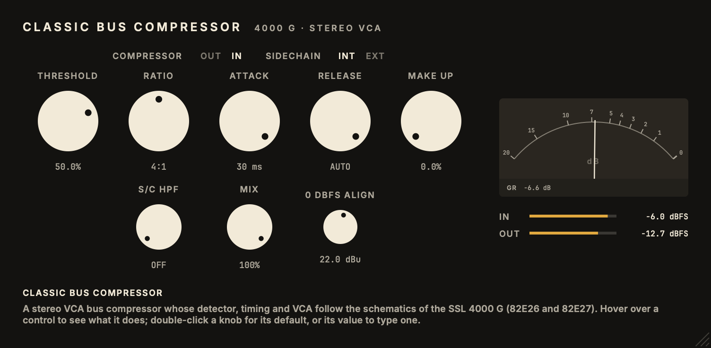

# Classic Bus Compressor

Inspired by the SSL 4000 G bus compressor.<br>
Part of the codycodie legacy release collection.

Classic Bus Compressor is a stereo VCA bus compressor plug-in built with JUCE 8 for AU and VST3. Its schematic-based DSP follows the compressor sections of the SSL 82E26 and 82E27 circuit drawings, with idealized device equations and plug-in extensions. It is not a component-exact recreation of a particular SSL unit.



This release has its own plug-in identity (`com.c0dypeng.classicbuscompressor`) so it can coexist with the original G Bus Compressor plug-in. Parameter IDs, order, ranges and defaults, along with the `SslBusState` saved-state root, remain stable for existing sessions and presets.

## Downloads

Get the latest builds from [GitHub Releases](https://github.com/chijenpeng/classic-bus-compressor/releases/latest). The macOS package provides universal AU and VST3 plug-ins for Apple Silicon and Intel Macs; it is ad-hoc signed and not notarized. The Windows package provides an unsigned x64 VST3 plug-in.

Existing DAW instances keep the original G Bus Compressor identity and will not be replaced automatically. The new Classic Bus Compressor identity can coexist with them; its parameter data schema remains compatible for manually transferred presets or state where the host supports it.

The control detents follow the
[SSL XLogic G-Series owner's manual](https://support.download.solidstatelogic.com/G-Series%20Bus%20Comp/G-Series%20Bus%20Compressor%20User%20Guide.pdf).

## Build

```sh
cmake -S . -B build -G Ninja -DCMAKE_BUILD_TYPE=Release
cmake --build build --target ClassicBusCompressor_AU ClassicBusCompressor_VST3 -j2
cmake --build build --target classic_bus_test classic_bus_snapshot -j2
ctest --test-dir build --output-on-failure
./build/classic_bus_snapshot_artefacts/Release/classic_bus_snapshot docs/editor.png
```

If `JUCE_SOURCE_DIR` is omitted, CMake uses `third_party/JUCE`, or fetches JUCE 8.0.9.
Plug-in copying is disabled by default. To copy AU and VST3 bundles into the current user's audio
plug-in folders, explicitly configure with `-DCOPY_PLUGIN_AFTER_BUILD=ON`.

## Controls

| Control | Range | Meaning |
| --- | --- | --- |
| Threshold | −100 to +100% | Position of the original 50k linear threshold pot. Lower settings compress more. |
| Ratio | 2:1, 4:1, 10:1 | Switches the original resistor and diode ratio network. |
| Attack | 0.1, 0.3, 1, 3, 10, 30 ms | Selects the original R1–R6 resistors. |
| Release | 0.1, 0.3, 0.6, 1.2 s, Auto | Selects the original RC branches; Auto solves both coupled capacitor nodes. |
| Make Up | 0–100% | Position of the original 25k linear make-up pot fed from +12 V through 4.7k. |
| S/C HPF | Off, 30, 60, 105, 125, 185 Hz | Filters detector only. This is a modern SSL extension. |
| External S/C | Off/On | Uses host sidechain input when connected. |
| Mix | 0–100% | Dry/wet parallel compression; 100% is classic. |
| 0 dBFS alignment | +12 to +30 dBu | Sets the analogue peak voltage represented by 0 dBFS. Default +22 dBu. |
| Compressor In | Off/On | Off is a bit-exact dry path. |

## Circuit mapping and limits

The [SSL 4000G service manual](https://funkwerkes.com/web/wp-content/techdocs/MixedProAudio/SSL-4000G-Console-Service-Manual-v1_1.pdf)
contains the original 82E26 and 82E27 schematics (PDF pages 203 and 206). The DSP implements:

| Schematic | Implemented equation |
| --- | --- |
| 82E26 C3/C4 with R7, C9 with R12, C11/C12 with R19, C18 with R34 | Three cascaded audio coupling poles near 1.06, 3.48 and 1.06 Hz; a detector coupling pole near 1.17 Hz. The internal detector taps the signal after the first audio coupling stage. |
| 82E26 dbx 202X, R11/R32 | Exponential VCA with the [202X data sheet](https://audiocircuit.dk/downloads/dbx/DBX-202-vca-sm.pdf) −20 dB/V control law, 83.2 Ω control loading and 1.25k internal input resistance. The sidechain's zero-control voltage gain is 33k/(91k+1.25k). R30 is a J112 switch, not a 47k resistor. The audio VCA uses R12=3.32k and R16=4.53k. |
| 82E26 T6/T7, R36–R45, D7 | Full-wave rectifier and the resistor/diode equations for all three ratio contacts. |
| Two 82E26 cards | Independent left/right detector paths with a common diode-OR timing feed and stereo VCA control. |
| 82E27 R1–R6, R9–R12, C3–C6 | Switched attack resistance and release RC branches, integrated each sample. |
| 82E27 C1/R7 and C2/R8 | Coupled two-node Auto release network, solved as a 2×2 nodal system. |
| 82E27 T2/T3, R19–R22, R25/R27 | Separate audio make-up and sidechain threshold control-voltage sums. R21 connects to the timing node, R27 is T3 feedback; the lines cross without a junction. The threshold pot voltage follows the 50k linear element and its ±12V, 3.9k end resistors. |

The threshold control now spans the drawn potentiometer's full travel. Its
percentage is physical wiper position, not a dBu mark. The default +50% is
a usable starting position, not a documented factory setting. The audio VCA
control resistor is set to an effective 100 Ω within the R72/RV3 trim range;
the drawing specifies adjustment by measurement, so its exact setting still
needs a reference unit. The make-up pot spans approximately 0–10.1 V at its
wiper, or roughly 0–14.7 dB of VCA gain with the stated audio control trim.
The ideal-diode and ideal-op-amp equations omit device tolerances, dbx 202X
distortion, noise, fader circuitry and rail-dependent transient behavior.
This is therefore a schematic-based DSP implementation, **not yet a verified
component-exact recreation of a particular SSL unit**. HPF, external sidechain,
parallel Mix and DAW alignment are plug-in extensions.
